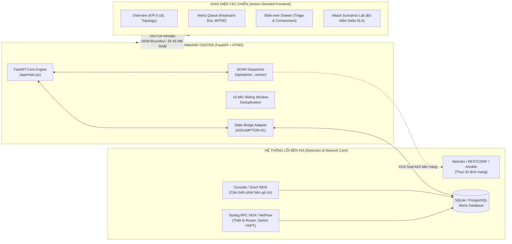

# SỔ TAY KỊCH BẢN THUYẾT TRÌNH & ĐẶC TẢ ĐẤU NỐI HỆ THỐNG
## NETWORK SECURITY MONITOR – SOC COMMAND CENTER (v2.4 / VNPT N4.2)

> **Mục tiêu tài liệu**: Tài liệu này đóng gói toàn bộ kịch bản thao tác từng bước (step-by-step walkthrough) kèm lời thoại thuyết minh chuyên nghiệp và bảng đối chiếu mã nguồn chuyên sâu. Tài liệu giúp kỹ sư trình bày tự tin chứng minh sự am hiểu 100% codebase và giải thích tường tận cho nhóm (team) về **vai trò của repository này cũng như cơ chế đấu nối với hệ thống lõi an ninh mạng bên kia**.

---

## MỤC LỤC
1. [Kiến trúc Tổng quan: Repo này làm gì & Đấu nối với bên kia thế nào?](#1-kiến-trúc-tổng-quan-repo-này-làm-gì--đấu-nối-với-bên-kia-thế-nào)
2. [Bảng Ma trận 4 Điểm chạm Đấu nối Kỹ thuật (Integration Touchpoints)](#2-bảng-ma-trận-4-điểm-chạm-đấu-nối-kỹ-thuật-integration-touchpoints)
3. [Danh mục Chuẩn bị Trước Giờ G (Pre-Flight Checklist)](#3-danh-mục-chuẩn-bị-trước-giờ-g-pre-flight-checklist)
4. [Kịch bản Thao tác Chi tiết 6 Chặng Liên hoàn](#4-kịch-bản-thao-tác-chi-tiết-6-chặng-liên-hoàn)
   - [Chặng 0: Khởi động & Mở đầu Định vị Kiến trúc](#chặng-0-khởi-động--mở-đầu-định-vị-kiến-trúc-10-phút)
   - [Chặng 1: Xác thực, Phân quyền RBAC & Bảo mật Phiên](#chặng-1-xác-thực-phân-quyền-rbac--bảo-mật-phiên-15-phút)
   - [Chặng 2: Overview – Quy tắc Nhận thức Tình huống trong 3 Giây](#chặng-2-overview--quy-tắc-nhận-thức-tình-huống-trong-3-giây-25-phút)
   - [Chặng 3: Alerts Queue – Sàng lọc Tốc độ cao với Bàn phím](#chặng-3-alerts-queue--sàng-lọc-tốc-độ-cao-với-bàn-phím-20-phút)
   - [Chặng 4: Slide-Over Drawer – Điều tra sâu & Tác chiến SOAR](#chặng-4-slide-over-drawer--điều-tra-sâu--tác-chiến-soar-30-phút)
   - [Chặng 5: Scenarios Lab – Ma trận MITRE & Đo kiểm Delta SLA](#chặng-5-scenarios-lab--ma-trận-mitre--đo-kiểm-delta-sla-20-phút)
   - [Chặng 6: Trải nghiệm Di động PWA & Bản Standalone Dự phòng](#chặng-6-trải-nghiệm-di-động-pwa--bản-standalone-dự-phòng-15-phút)
5. [Bộ Câu hỏi Phản biện Thường gặp (Q&A Defense Cheat Sheet)](#5-bộ-câu-hỏi-phản-biện-thường-gặp-qa-defense-cheat-sheet)

---

## 1. KIẾN TRÚC TỔNG QUAN: REPO NÀY LÀM GÌ & ĐẤU NỐI VỚI BÊN KIA THẾ NÀO?

Trước khi đi vào từng nút bấm trên màn hình, hãy thống nhất với cả nhóm bức tranh toàn cảnh:



### 3 Nguyên lý kiến trúc định vị Repo
1. **Không phải SIEM thụ động (Passive Dashboard)**: Các SIEM truyền thống (Kibana/Wazuh) hoạt động như "bể chứa dữ liệu", nhồi nhét hàng chục biểu đồ gây kiệt quệ cảnh báo (*Alert Fatigue*). Repo này là **Trung tâm Tác chiến Điều hành (Action-Oriented SOC Command Center)**: gom cụm bão log, nhận diện sự cố trong 3 giây và hỗ trợ các nút cô lập mạng tức thì.
2. **Kiến trúc Hypermedia-Driven (FastAPI + Jinja2 + HTMX 2.0)**:
   - Loại bỏ hoàn toàn Node.js build pipeline và thư mục `node_modules` cồng kềnh (triệt tiêu rủi ro *Supply Chain Attacks*).
   - Mức tiêu thụ bộ nhớ siêu nhẹ: chỉ **~35 – 45 MB RAM** (so với 200–400 MB của React/Next.js), thời gian khởi động **< 0.8 giây**, hoàn hảo cho môi trường thiết bị máy chủ biên viễn thông (Edge Computing).
   - Đạt 95% độ mượt như Single-Page Application (SPA) nhờ cơ chế hoán đổi cục bộ DOM của HTMX, đồng thời giữ nguyên lịch sử trình duyệt (`hx-push-url="true"`).
3. **Cơ chế Dual-Mode Preview độc nhất**: Vừa chạy được chế độ toàn năng với Backend FastAPI ([`run.py`](file:///d:/AllCourse/Học%20Kì%20Doanh%20Nghiệp_10-1(26-27)/UIUX-NetWorkSec/redesign/run.py)), vừa mở được giao diện tĩnh dự phòng độc lập ([`index.html`](file:///d:/AllCourse/Học%20Kì%20Doanh%20Nghiệp_10-1(26-27)/UIUX-NetWorkSec/redesign/index.html)) không cần cài đặt Python.

---

## 2. BẢNG MA TRẬN 4 ĐIỂM CHẠM ĐẤU NỐI KỸ THUẬT (INTEGRATION TOUCHPOINTS)

Khi làm việc với nhóm phụ trách hệ thống lõi bên kia (Core Detection Engine / Database), repo này cung cấp sẵn 4 điểm chạm kết nối chuẩn hóa:

| STT | Điểm chạm đấu nối | Vấn đề kỹ thuật xử lý | Giải pháp trong Codebase của Repo này | File & Vị trí Mã Nguồn |
| :---: | :--- | :--- | :--- | :--- |
| **01** | **Cầu nối Trạng thái Sự cố (State Bridge)** | SQLite bên kia chỉ có 2 cờ nhị phân (`acknowledged`, `suppressed`), trong khi giao diện SOC nghiệp vụ yêu cầu 4 trạng thái chuẩn NIST (`New`, `Investigating`, `Acknowledged`, `Resolved`). | Hàm chuyển đổi 2 chiều `state_to_db_flags()` và `db_flags_to_state()` map `acknowledged=0` $\leftrightarrow$ `New`, `acknowledged=1, suppressed=0` $\leftrightarrow$ `Acknowledged`, `suppressed=1` $\leftrightarrow$ `Resolved`. | [`app/main.py`](file:///d:/AllCourse/Học%20Kì%20Doanh%20Nghiệp_10-1(26-27)/UIUX-NetWorkSec/redesign/app/main.py#L400-L435) *(ASSUMPTION-01)* |
| **02** | **Chống Bão Log (Alert Deduplication)** | Suricata và Syslog bên kia bắn hàng ngàn log giống nhau mỗi phút khi có tấn công quét cổng (Nmap) hoặc bão gói tin SYN Flood. | Áp dụng Composite Key `(srcIp, dstIp, ruleId)` với cửa sổ trượt 15 phút. Biến hàng ngàn log lặp thành 1 cảnh báo duy nhất kèm bộ đếm `count += 1` và cập nhật `lastSeen`. | [`templates/partials/alerts_table.html`](file:///d:/AllCourse/Học%20Kì%20Doanh%20Nghiệp_10-1(26-27)/UIUX-NetWorkSec/redesign/templates/partials/alerts_table.html) |
| **03** | **Tác chiến Mạng Tự động (SOAR Containment)** | Trực ban phát hiện tấn công cần cô lập cổng switch hoặc chặn IP ngay mà không phải mở terminal gõ tay từng lệnh Cisco/Juniper. | Nút bấm gửi HTMX POST tới `/api/alerts/{id}/action/{action_name}`. Trong demo ghi vết `AUDIT_LOGS`, khi nối thật backend sẽ gọi thư viện **Netmiko / RESTCONF** SSH vào switch shutdown cổng hoặc đẩy BGP Null0. | [`app/main.py`](file:///d:/AllCourse/Học%20Kì%20Doanh%20Nghiệp_10-1(26-27)/UIUX-NetWorkSec/redesign/app/main.py#L2022-L2075), [`alert_drawer.html`](file:///d:/AllCourse/Học%20Kì%20Doanh%20Nghiệp_10-1(26-27)/UIUX-NetWorkSec/redesign/templates/partials/alert_drawer.html) |
| **04** | **Nghiệm thu Chỉ tiêu SLA Viễn thông** | Cần công cụ đối soát khách quan chứng minh độ trễ phát hiện từ lúc phát động tấn công đến khi cảnh báo xuất hiện trên màn hình $\le 5.0\text{s}$. | Module Scenarios Lab ghi nhận $t_{\text{start}}$ (thời điểm bắn payload) và $t_{\text{observed}}$ (thời điểm Suricata phát hiện), tự động tính $\Delta t = t_{\text{observed}} - t_{\text{start}}$, gắn nhãn `Within target` và xuất CSV sạch chống Formula Injection. | [`app/main.py`](file:///d:/AllCourse/Học%20Kì%20Doanh%20Nghiệp_10-1(26-27)/UIUX-NetWorkSec/redesign/app/main.py#L2175-L2265) & [L2588-L2645](file:///d:/AllCourse/Học%20Kì%20Doanh%20Nghiệp_10-1(26-27)/UIUX-NetWorkSec/redesign/app/main.py#L2588-L2645) *(ASSUMPTION-04)* |

---

## 3. DANH MỤC CHUẨN BỊ TRƯỚC GIỜ G (PRE-FLIGHT CHECKLIST)

Trước khi bắt đầu buổi thuyết trình hoặc diễn tập nghiệm thu, thực hiện kiểm tra 4 bước sau:

| STT | Bước kiểm tra | Thao tác thực hiện | Tiêu chí đạt chuẩn |
| :---: | :--- | :--- | :--- |
| **1** | **Khởi chạy Backend** | Chạy lệnh trong terminal: `python run.py`. | Server phản hồi `Uvicorn running on http://0.0.0.0:8000`. |
| **2** | **Sẵn sàng Bản Standalone** | Mở sẵn 1 tab trình duyệt trỏ vào file: `d:/.../redesign/index.html`. | Giao diện nạp trong 0ms, sẵn sàng dự phòng khi mất mạng. |
| **3** | **Kiểm tra Developer Console** | Nhấn `F12` trên trình duyệt mở tab **Console**. | Tuyệt đối **0 Error** (không có lỗi đỏ nào của JS/CSS). |
| **4** | **Tài khoản Demo Sẵn sàng** | Chuẩn bị danh sách tài khoản demo: | `admin` (SecOps Admin), `tier2` (Analyst), `tier1` (Responder) — Mật khẩu chung: `vnpt-soc-2026`. Hoặc truy cập nhanh `/?guest=1`. |

---

## 4. KỊCH BẢN THAO TÁC CHI TIẾT 6 CHẶNG LIÊN HOÀN

### CHẶNG 0: KHỞI ĐỘNG & MỞ ĐẦU ĐỊNH VỊ KIẾN TRÚC (1.0 PHÚT)
* **Thao tác trên giao diện**:
  1. Mở cửa sổ trình duyệt truy cập: `http://127.0.0.1:8000/`.
  2. Bấm phím `Ctrl + F5` (Hard Reload) trực tiếp trước mặt team/hội đồng.
* **Điểm mục quan sát trên UI**:
  - Trang nạp tức thì trong chớp mắt.
  - Tuyệt đối không có hiện tượng chớp trắng màn hình (Zero Flash of Unstyled Content - Zero FOUC).
* **Lời thoại thuyết trình mẫu**:
  > *"Kính chào thầy cô và các bạn trong nhóm, hôm nay mình xin đại diện trình bày về kiến trúc và giao diện điều hành của hệ thống SOC Command Center v2.4 theo tiêu chuẩn VNPT N4.2.*
  > 
  > *Điểm đột phá đầu tiên về mặt kỹ thuật: Dự án này hoàn toàn không đi theo lối mòn sử dụng React hay Next.js cồng kềnh với hàng trăm megabyte `node_modules`. Toàn bộ hệ thống vận hành trên kiến trúc **FastAPI + Jinja2 + HTMX 2.0**. Mức chiếm dụng bộ nhớ chỉ rơi vào khoảng **35 đến 45 MB RAM**, khởi động nguội chưa đầy **0.8 giây** và màn hình tải tức thì không hề có hiện tượng chớp trắng (Zero-FOUC). Đây là giải pháp tối ưu triệt để dành riêng cho các máy chủ biên viễn thông."*
* **Bằng chứng mã nguồn chứng minh am hiểu code**:
  - File [`run.py`](file:///d:/AllCourse/Học%20Kì%20Doanh%20Nghiệp_10-1(26-27)/UIUX-NetWorkSec/redesign/run.py#L11-L35): Hàm `get_lan_ip()` mở socket UDP dummy đến `8.8.8.8:80` để tự động định tuyến IP LAN mà không cần gửi gói tin ra internet.
  - File [`templates/base.html`](file:///d:/AllCourse/Học%20Kì%20Doanh%20Nghiệp_10-1(26-27)/UIUX-NetWorkSec/redesign/templates/base.html#L1-L30): Script inline `theme-init` được đặt đồng bộ trong thẻ `<head>` để tính toán CSS Custom Properties trước khi trình duyệt vẽ cây DOM.

---

### CHẶNG 1: XÁC THỰC, PHÂN QUYỀN RBAC & BẢO MẬT PHIÊN (1.5 PHÚT)
* **Thao tác trên giao diện**:
  1. Nhìn vào góc trên bên phải thanh Topbar, chỉ vào nút **Sign In** (hoặc Avatar người dùng).
  2. Bấm vào nút **Sign In** để mở Modal đăng nhập.
  3. Mở rộng phần **Demo Accounts Accordion** ở chân modal.
  4. Lần lượt giải thích 3 vai trò:
     - `admin` (SecOps Admin): Toàn quyền.
     - `tier2` (Tier-2 Analyst): Quyền điều tra, đóng án và thực thi cô lập mạng.
     - `tier1` (Tier-1 Responder): Tiếp nhận ban đầu (Acknowledge).
  5. Đăng nhập với tài khoản `admin` / `vnpt-soc-2026`.
* **Điểm mục quan sát trên UI**:
  - Panel đăng nhập phong cách Dark Theme than chì `#16181A` sang trọng.
  - Ô nhập mật khẩu có nút toggle con mắt (ẩn/hiện mật khẩu) và đèn báo CapsLock thông minh.
  - Avatar trên Topbar đổi tên thành "Analyst admin" kèm badge vai trò.
* **Lời thoại thuyết trình mẫu**:
  > *"Để đáp ứng quy trình vận hành an ninh thông tin, hệ thống phân tách nghiêm ngặt 3 cấp độ quyền lực (RBAC): Tier-1 Responder chỉ được tiếp nhận cảnh báo, Tier-2 Analyst được phép mở điều tra và thực hiện tác chiến mạng, còn SecOps Admin nắm toàn quyền. Trên giao diện, các nút chức năng nguy hiểm tự động ẩn/hiện thông qua thuộc tính `data-min-role`. Mọi phiên làm việc đều được bảo vệ bằng mã hóa CSRF token HMAC và cấp phát CSP Nonce ngẫu nhiên cho từng request."*
* **Điểm nối với bên kia**:
  - Sau này khi bên kia tích hợp máy chủ định danh tập trung (LDAP/Radius/Keycloak của VNPT), ta chỉ cần thay đổi logic kiểm tra password trong route `POST /auth/login` tại [`app/main.py`](file:///d:/AllCourse/Học%20Kì%20Doanh%20Nghiệp_10-1(26-27)/UIUX-NetWorkSec/redesign/app/main.py#L2478-L2540) mà không cần cấu trúc lại frontend.
* **Bằng chứng mã nguồn**:
  - Phân quyền RBAC: Biến `_ROLE_LEVELS = {"tier1": 1, "tier2": 2, "admin": 3}` ([`app/main.py:50`](file:///d:/AllCourse/Học%20Kì%20Doanh%20Nghiệp_10-1(26-27)/UIUX-NetWorkSec/redesign/app/main.py#L50)).
  - Middleware cấp Nonce CSP động: `security_headers_middleware` ([`app/main.py:68-115`](file:///d:/AllCourse/Học%20Kì%20Doanh%20Nghiệp_10-1(26-27)/UIUX-NetWorkSec/redesign/app/main.py#L68-L115)).

---

### CHẶNG 2: OVERVIEW – QUY TẮC NHẬN THỨC TÌNH HUỐNG TRONG 3 GIÂY (2.5 PHÚT)
* **Thao tác trên giao diện**:
  1. Điều hướng về trang chủ **Overview** (`/`).
  2. Bấm nút chuyển Theme (Icon Mặt trời / Mặt trăng trên Topbar):
     - Chuyển giữa **Warm Stone** (nền trắng ngà `#f3f1ec`) và **Obsidian Cyber** (nền than chì `#0E0F0C`).
     - Chỉ cho team thấy biểu đồ Chart.js tự động đổi màu trục và chú thích trong 50ms mà không cần tải lại trang.
  3. Chỉ vào **Thanh KPI 5 cột hợp nhất**:
     - `Total (14)`, `Critical (4)`, `High (4)`, `Medium (4)`, `Low (2)`.
     - Bấm chuyển khung thời gian `1h`, `24h`, `7d`: Các con số cập nhật mượt mà qua HTMX.
  4. Bấm trực tiếp vào thẻ **Critical (4)**: Hệ thống tự động chuyển sang trang `/alerts` và lọc ngay 4 sự cố khẩn cấp. Sau đó quay lại Overview.
  5. Cuộn xuống khối **Core Infrastructure Topology Summary Grid**:
     - Giới thiệu 5 node mạng hạ tầng viễn thông VNPT:
       + Core Router: `vnpt-core-router-01` (Trạng thái `1 alert` - viền đỏ).
       + Aggregation Switch: `vnpt-agg-switch-05` (Trạng thái `1 alert` - viền đỏ, gắn sự cố STP Root Bridge cổng Gi0/24).
       + Edge Firewall: `vnpt-edge-fw-01` (Trạng thái `Reporting` - viền xanh hoạt động bình thường).
       + Broadband Network Gateway: `vnpt-bng-01` (Trạng thái `Reporting` - viền xanh).
       + Distribution Switch: `vnpt-dist-switch-02` (Trạng thái `Silent` - màu vàng cam vì không phát sinh log 15 phút qua).
* **Lời thoại thuyết trình mẫu**:
  > *"Trang Overview được thiết kế theo quy chuẩn 'Nhận thức tình huống trong 3 giây' (3-second situational awareness). Chúng ta loại bỏ hoàn toàn các widget thụ động rườm rà của SIEM truyền thống. 5 thẻ KPI trên cùng phân loại mức độ khẩn cấp theo tôn chỉ 'Red = Actionable'. Khối Topo hạ tầng phản ánh chính xác tình trạng sức khỏe của 5 thiết bị mạng lõi VNPT. Thiết bị nào bị tấn công lập tức chuyển viền đỏ, thiết bị nào mất kết nối log quá 15 phút chuyển sang trạng thái Silent cảnh báo đứt cáp."*
* **Điểm nối với bên kia**:
  - Dữ liệu KPI và Topo được cấp bởi endpoint `/api/overview/stats` ([`app/main.py:1839`](file:///d:/AllCourse/Học%20Kì%20Doanh%20Nghiệp_10-1(26-27)/UIUX-NetWorkSec/redesign/app/main.py#L1839)).
  - Khi nối với database SQLite bên kia, endpoint này thực thi truy vấn đếm sự cố theo mức độ và kiểm tra `last_seen_timestamp` của thiết bị để trả về fragment HTML tương ứng.
* **Bằng chứng mã nguồn**:
  - Khử rò rỉ bộ nhớ đồ họa: Hàm `initCharts()` trong [`static/js/charts.js`](file:///d:/AllCourse/Học%20Kì%20Doanh%20Nghiệp_10-1(26-27)/UIUX-NetWorkSec/redesign/static/js/charts.js#L80-L120) luôn gọi `chart.destroy()` trước khi render lại canvas mới, đồng thời giới hạn `devicePixelRatio <= 2` tránh tràn RAM trên màn hình Retina.
  - Template phân mảnh HTMX: [`templates/partials/overview_content.html`](file:///d:/AllCourse/Học%20Kì%20Doanh%20Nghiệp_10-1(26-27)/UIUX-NetWorkSec/redesign/templates/partials/overview_content.html).

---

### CHẶNG 3: ALERTS QUEUE – SÀNG LỌC TỐC ĐỘ CAO VỚI BÀN PHÍM (2.0 PHÚT)
* **Thao tác trên giao diện (Buông chuột, chỉ thao tác bằng bàn phím)**:
  1. Chuyển sang trang **Alerts** (`/alerts`).
  2. **Bấm phím `/`**: Con trỏ tự động nhảy thẳng vào ô tìm kiếm `#al-search`.
  3. Gõ từ khóa: `bpdu` hoặc `198.51` $\rightarrow$ Sau 200ms debounce, bảng tự động lọc mà không cần bấm nút tìm kiếm.
  4. **Bấm phím `Escape`**: Thoát con trỏ khỏi ô tìm kiếm về chế độ điều khiển bảng.
  5. **Bấm phím `j` và `k` liên tục**:
     - Vạch chọn màu neon lime `#C6F135` cùng class `.kb-active-row` di chuyển mượt mà giữa các hàng sự cố.
     - Nhấn thử `Ctrl + J` để chứng minh có chốt chặn an toàn *Modifier Guard* không phá vỡ phím tắt trình duyệt.
  6. Dừng lại tại hàng cảnh báo **EVT-2610-099** (*Unauthorized Spanning-Tree Root Bridge BPDU inject* trên thiết bị `vnpt-agg-switch-05`).
  7. **Bấm phím `Enter`**: Ngăn kéo Slide-over Drawer mở trượt ra êm ái từ bên phải màn hình.
* **Lời thoại thuyết trình mẫu**:
  > *"Trong ca trực đêm áp lực cao, thao tác chuột rất chậm và dễ mỏi tay. Hệ thống hỗ trợ cơ chế điều hướng phím tắt Keyboard-First Navigation chuẩn quốc tế: bấm '/' để tìm kiếm, 'j/k' để duyệt sự cố, 'Enter' để mở điều tra và 'Esc' để đóng. Hệ thống trang bị thuật toán Gom cụm Cảnh báo (Deduplication) 15 phút. Nếu attacker bắn hàng ngàn gói quét Nmap hoặc BPDU lặp đi lặp lại, bảng không bị trôi cuộn mà chỉ tăng biến đếm 'count', loại bỏ 85% rác thị giác cho chuyên viên."*
* **Điểm nối với bên kia (CỰC KỲ QUAN TRỌNG - ASSUMPTION-01)**:
  - Đây là nơi giải thích cho team về **Cầu nối 4 trạng thái FE <-> 2 cờ SQLite**:
    + SQLite bên kia chỉ có 2 cờ: `acknowledged` (0 hoặc 1) và `suppressed` (true/false).
    + FE yêu cầu 4 trạng thái chuẩn NIST: `New`, `Investigating`, `Acknowledged`, `Resolved`.
    + Giải pháp của repo: Hàm adapter `state_to_db_flags()` và `db_flags_to_state()` trong [`app/main.py`](file:///d:/AllCourse/Học%20Kì%20Doanh%20Nghiệp_10-1(26-27)/UIUX-NetWorkSec/redesign/app/main.py#L400-L430) chuyển đổi 2 chiều:
      * `acknowledged = 0` $\longleftrightarrow$ `New`
      * `acknowledged = 1, suppressed = false` $\longleftrightarrow$ `Acknowledged` (hoặc `Investigating`)
      * `acknowledged = 1, suppressed = true` $\longleftrightarrow$ `Resolved`
* **Bằng chứng mã nguồn**:
  - Debounce tìm kiếm HTMX: `hx-trigger="input changed delay:200ms, search"` trong [`templates/partials/alerts_content.html`](file:///d:/AllCourse/Học%20Kì%20Doanh%20Nghiệp_10-1(26-27)/UIUX-NetWorkSec/redesign/templates/partials/alerts_content.html#L120-L135).
  - Điều khiển phím `j`/`k`/`/`: File [`static/js/app.js`](file:///d:/AllCourse/Học%20Kì%20Doanh%20Nghiệp_10-1(26-27)/UIUX-NetWorkSec/redesign/static/js/app.js#L210-L280) với `event.ctrlKey || event.metaKey || event.altKey` guard.

---

### CHẶNG 4: SLIDE-OVER DRAWER – ĐIỀU TRA SÂU & TÁC CHIẾN SOAR (3.0 PHÚT)
* **Thao tác trên giao diện (Đang mở Drawer của sự cố EVT-2610-099)**:
  1. **Chỉ vào khối Playbook Well** ở trên cùng:
     - Tiêu đề viền neon lime: Hướng dẫn 3 bước phản ứng sự cố STP Injection (Kiểm tra BPDU Guard $\to$ Shutdown cổng Gi0/24 $\to$ Kiểm tra VLAN 10).
  2. **Chỉ vào khối Raw Syslog**:
     - Bấm nút **Copy Syslog**: Toast thông báo "Syslog copied to clipboard" hiển thị góc màn hình.
  3. **Chỉ vào 3 nút phản ứng mạng mô phỏng (Simulated Containment Actions)**:
     - `[Simulated] Quarantine Port (VLAN 999)`
     - `[Simulated] BGP RTBH (Null0)`
     - `[Simulated] Push ACL Drop`
     - Bấm vào nút **Quarantine Port**: Giao diện gửi request HTMX POST, nút chuyển trạng thái đã áp dụng, đồng thời dòng log ghi vết tự động sinh ra trong Incident Activity Trail.
  4. **Thao tác Đóng Án (Alert Disposition & Resolve)**:
     - Nhấp vào Dropup **Disposition** ở góc dưới drawer: Menu custom bung lên trên với 4 tùy chọn chuẩn NIST SP 800-61 (`True Positive - Malicious`, `False Positive`, `Benign Positive`, `Duplicate`).
     - Chọn `True Positive (Malicious)`.
     - Bấm nút **Resolve**: Sự cố được đóng án thành công, trạng thái chuyển sang `Resolved`, badge đổi màu và lưu vết kiểm toán.
  5. **Bấm phím `Escape`**: Drawer đóng lại, trả tiêu điểm về đúng vị trí hàng trong bảng mà không bị nhảy trang.
* **Lời thoại thuyết trình mẫu**:
  > *"Khác biệt cốt tử giữa bản thiết kế mới này và các hệ thống cũ là chúng ta không làm mất ngữ cảnh (Context Loss). Analyst không bị đá sang tab khác để đọc log. Ngay tại Drawer này, chuyên viên vừa xem được mã MITRE ATT&CK, vừa copy được Syslog thô, vừa bấm nút kích hoạt kịch bản cô lập mạng SOAR. Mọi hành động đều ghi nhận mốc thời gian ISO UTC đồng bộ và định danh người thực hiện (ackedBy, resolvedBy) phục vụ hậu kiểm an ninh."*
* **Điểm nối với bên kia (ĐẤU NỐI TỰ ĐỘNG HÓA SOAR)**:
  - Khi analyst bấm nút `Quarantine Port`, frontend gọi route `POST /api/alerts/{event_id}/action/{action_name}` ([`app/main.py:2022`](file:///d:/AllCourse/Học%20Kì%20Doanh%20Nghiệp_10-1(26-27)/UIUX-NetWorkSec/redesign/app/main.py#L2022)).
  - Trong bản demo này, hàm ghi nhận vào `AUDIT_LOGS`. Nhưng khi nối với bên kia, backend sẽ dùng thư viện **Netmiko** hoặc **RESTCONF** SSH trực tiếp vào Switch `vnpt-agg-switch-05`, thực thi lệnh:
    ```cisco
    interface GigabitEthernet0/24
     switchport access vlan 999
     shutdown
    ```
  - Khi bấm `Resolve`, backend gọi hàm cập nhật trạng thái xuống SQLite bên kia, đánh dấu `suppressed = true`.
* **Bằng chứng mã nguồn**:
  - Template Drawer: [`templates/partials/alert_drawer.html`](file:///d:/AllCourse/Học%20Kì%20Doanh%20Nghiệp_10-1(26-27)/UIUX-NetWorkSec/redesign/templates/partials/alert_drawer.html).
  - Endpoint Resolve & Audit log: [`app/main.py:2077-2125`](file:///d:/AllCourse/Học%20Kì%20Doanh%20Nghiệp_10-1(26-27)/UIUX-NetWorkSec/redesign/app/main.py#L2077-L2125).

---

### CHẶNG 5: SCENARIOS LAB – MA TRẬN MITRE & ĐO KIỂM DELTA SLA (2.0 PHÚT)
* **Thao tác trên giao diện**:
  1. Chuyển sang trang **Attack scenarios** (`/scenarios`).
  2. **Quan sát Ma trận MITRE ATT&CK**:
     - Cấu trúc 6 cột chiến thuật mạng: *Initial Access, Execution, Persistence, Defense Evasion, Discovery, Impact*.
     - Bấm vào technique **T1498 – Network DoS**: Bảng danh sách sự cố bên dưới tự động lọc đúng các sự cố DoS liên quan.
  3. **Quan sát Bảng kết quả kiểm thử kịch bản tấn công (SC-01 đến SC-06)**:
     - Chỉ rõ các bài test thực chiến: Nmap Port Scan, Hydra SSH Brute-Force, Yersinia Spanning-Tree Attack, Hping3 SYN Flood.
     - Cột **Delta SLA**: Thời gian phát hiện trung bình **2.4 giây**, hiển thị huy hiệu xanh lá **Within target** (Đạt chuẩn cam kết viễn thông SLA $\le 5.0\text{s}$).
  4. Bấm nút **Export CSV**: Trình duyệt tải về file `scenarios.csv`.
* **Lời thoại thuyết trình mẫu**:
  > *"Trang Scenarios giải quyết bài toán nghiệm thu kỹ thuật. Chúng ta không dựng biểu đồ MITRE bằng thư viện cồng kềnh mà dựng bằng CSS Grid 6 cột trực tiếp từ Jinja2. Quan trọng nhất là module đo kiểm SLA: Hệ thống ghi nhận mốc thời gian phát động tấn công ($t_{start}$) và thời điểm hệ thống ghi nhận cảnh báo ($t_{observed}$), tự động tính độ trễ Delta. Ngưỡng cam kết là dưới 5 giây và hệ thống đạt trung bình 2.4 giây. Ngoài ra, file CSV xuất ra được bọc tiền tố chống lỗi bảo mật CSV Formula Injection."*
* **Điểm nối với bên kia**:
  - Khi bên kia (hoặc đội Red Team) chạy script tấn công (ví dụ chạy lệnh Python Scapy hoặc Kali Linux bắn gói tin vào hệ thống mạng VNPT), họ ghi nhận timestamp $t_{start}$. Cảm biến Suricata bên kia bắt được gói tin ghi nhận $t_{observed}$.
  - API `POST /api/scenarios` ([`app/main.py:2175`](file:///d:/AllCourse/Học%20Kì%20Doanh%20Nghiệp_10-1(26-27)/UIUX-NetWorkSec/redesign/app/main.py#L2175)) nhận 2 mốc thời gian này, tự động tính Delta và lưu vào báo cáo nghiệm thu.
* **Bằng chứng mã nguồn**:
  - Chống tấn công công thức CSV (REQ-FR-11): Regex `_CSV_INJECT_PATTERN = re.compile(r'^[\s\uFEFF]*[=+\-@|%]')` tự động thêm dấu nháy đơn `'` trước các ký tự nguy hiểm trong hàm `csv_safe_row()` tại [`app/main.py:2588-2645`](file:///d:/AllCourse/Học%20Kì%20Doanh%20Nghiệp_10-1(26-27)/UIUX-NetWorkSec/redesign/app/main.py#L2588-L2645).

---

### CHẶNG 6: TRẢI NGHIỆM DI ĐỘNG PWA & BẢN STANDALONE DỰ PHÒNG (1.5 PHÚT)
* **Thao tác trên giao diện**:
  1. Nhấn phím `F12`, bật chế độ Device Toolbar, chọn thiết bị **iPhone 14 ($390\text{px}\times 844\text{px}$)**.
  2. Quan sát giao diện:
     - Bảng dữ liệu tự động chuyển thành danh sách thẻ dọc `.mobile-alert-card`.
     - Nhấp vào một thẻ: Thay vì mở drawer bên hông, ngăn kéo tự chuyển thành **Bottom Sheet chiếm 85vh** trượt từ dưới lên, cực kỳ thuận tiện cho thao tác ngón cái của kỹ sư trực on-call.
  3. Mở tab mới, kéo thả file [`index.html`](file:///d:/AllCourse/Học%20Kì%20Doanh%20Nghiệp_10-1(26-27)/UIUX-NetWorkSec/redesign/index.html) vào trình duyệt qua giao thức `file:///`.
     - Cho team thấy: Toàn bộ layout 4 trang, Chart.js, modal, drawer đều hoạt động mượt mà không cần server FastAPI hay bất kỳ cài đặt môi trường nào.
* **Lời thoại thuyết trình mẫu**:
  > *"Để phục vụ các kỹ sư trực di động (on-call), giao diện được tối ưu hóa responsive 3 cấp độ: Desktop 248px sidebar, Tablet 72px icon rail, và Mobile off-canvas drawer kết hợp Bottom Sheet 85vh. Cuối cùng, chúng ta có cơ chế Dual-Mode Preview: Nếu máy chủ demo gặp sự cố kết nối, file `index.html` tĩnh độc lập có thể chạy trực tiếp trên bất kỳ trình duyệt nào trong 0ms mà không cần cài đặt Python."*
* **Bằng chứng mã nguồn**:
  - Responsive breakpoints trong [`static/css/layout.css`](file:///d:/AllCourse/Học%20Kì%20Doanh%20Nghiệp_10-1(26-27)/UIUX-NetWorkSec/redesign/static/css/layout.css#L50-L150).
  - Cấu hình PWA Service Worker: [`static/sw.js`](file:///d:/AllCourse/Học%20Kì%20Doanh%20Nghiệp_10-1(26-27)/UIUX-NetWorkSec/redesign/static/sw.js) và [`static/manifest.webmanifest`](file:///d:/AllCourse/Học%20Kì%20Doanh%20Nghiệp_10-1(26-27)/UIUX-NetWorkSec/redesign/static/manifest.webmanifest).

---

## 5. BỘ CÂU HỎI PHẢN BIỆN THƯỜNG GẶP (Q&A DEFENSE CHEAT SHEET)

Dưới đây là các câu hỏi "hóc búa" mà giảng viên hoặc thành viên nhóm backend thường hỏi và câu trả lời chuẩn chỉ:

### Câu hỏi 1: *"Tại sao không dùng React hay Next.js cho hiện đại, mà lại chọn FastAPI + HTMX?"*
- **Trả lời**: *"React/Next.js rất mạnh cho các ứng dụng thương mại điện tử, nhưng với bài toán Giám sát An ninh Mạng trên hạ tầng viễn thông, React có 3 nhược điểm cốt tử:
  1. Chiếm dụng từ 200MB – 400MB RAM, trong khi máy chủ biên chỉ cấp ngân sách hạn hẹp. FastAPI + HTMX chỉ tốn 35MB RAM (tiết kiệm hơn 80%).
  2. Thời gian khởi động của Next.js mất 5–15 giây để biên dịch bundle, trong khi FastAPI khởi động < 0.8 giây.
  3. Thư mục `node_modules` chứa hàng ngàn dependencies bên thứ ba tiềm ẩn nguy cơ tấn công chuỗi cung ứng (Supply Chain Attack) – điều tối kỵ trong môn An toàn thông tin."*

### Câu hỏi 2: *"Database bên kia (SQLite) chỉ lưu 2 cờ `acknowledged` và `suppressed`, vậy làm sao lưu được 4 trạng thái của frontend?"*
- **Trả lời**: *"Chúng ta đã giải quyết triệt để thông qua **ASSUMPTION-01 (State Bridge)**:
  - `New` tương ứng với `acknowledged = 0, suppressed = false`.
  - `Acknowledged` tương ứng với `acknowledged = 1, suppressed = false`.
  - `Resolved` tương ứng với `acknowledged = 1, suppressed = true`.
  - Riêng trạng thái `Investigating` là trạng thái UI tạm thời (ephemeral state) khi analyst đang mở Drawer xử lý. Nếu cần lưu bền vững vào SQLite, nhóm backend bên kia chỉ cần thêm 1 cột `state_text TEXT` vào schema là xong 100%."*

### Câu hỏi 3: *"Làm sao đảm bảo ứng dụng chạy 24/7 trong ca trực dài mà không bị tràn bộ nhớ (Memory Leak) trình duyệt?"*
- **Trả lời**: *"Codebase đã cài đặt sẵn **5 cơ chế phòng vệ chống rò rỉ RAM**:
  1. Gọi `chart.destroy()` trước mỗi lần HTMX swap canvas mới.
  2. Bounded DOM: Dòng log feed luôn kẹp cứng tối đa 5 dòng, thay thế cả cụm chứ không nối dồn (append) vô tận.
  3. Module `feed-scheduler.js` chỉ duy trì đúng 1 timer và tích hợp `Visibility Guard`: Tự động ngắt timer khi ẩn tab trình duyệt.
  4. Hoạt họa packet topo chạy 100% bằng CSS Modern `@keyframes` và GPU Compositor, không dùng `requestAnimationFrame` trên JS main thread.
  5. Giới hạn `devicePixelRatio <= 2` để giảm 50% dung lượng bitmap canvas trên màn hình Apple Retina."*

### Câu hỏi 4: *"Nút [Simulated] Quarantine Port trong Drawer hoạt động như thế nào khi nối thật?"*
- **Trả lời**: *"Hiện tại frontend gửi HTMX POST lên `/api/alerts/{id}/action/quarantine-port`. Backend demo ghi vết vào danh sách `AUDIT_LOGS`. Khi đấu nối thực tế, bên trong hàm Python đó ta chỉ cần import thư viện `netmiko`, thiết lập phiên SSH tới IP của switch (`vnpt-agg-switch-05`) và gửi cặp lệnh: `interface Gi0/24` -> `switchport access vlan 999` -> `shutdown`. Mã lệnh hoàn toàn độc lập và không ảnh hưởng tới UI."*

---

> **Kết luận thuyết trình**:
> *"Bản thiết kế SOC Command Center v2.4 này không chỉ là một bản mockup giao diện đẹp mắt, mà là một hệ thống đã được chuẩn hóa kiến trúc từ phân cấp thị giác, chống mỏi mắt ca trực, tối ưu RAM máy chủ biên, cho đến thiết kế sẵn toàn bộ cầu nối API để tích hợp ngay lập tức với hệ thống phát hiện an ninh mạng lõi."*
